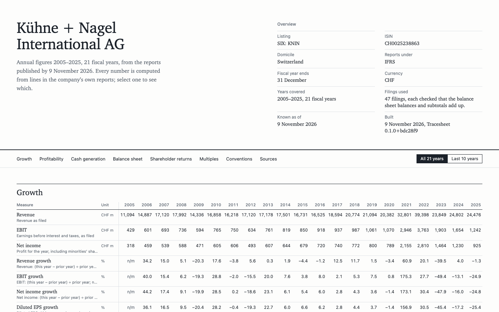

# Tracesheet

Tracesheet turns a company's annual-report figures into a multi-year evaluation sheet in
which every number traces back to the page it came from. Select any figure on the sheet, a
margin, a return on capital or a valuation multiple, and it opens the trail: the filed lines
it was computed from, each naming the report, the printed page and the report's own label
for the line.

Tracesheet grew out of a private investment-research project; this is its public, method-free
core.

The sample sheet covers Kühne+Nagel from 2005 to 2025, built from 47 filings:
[`examples/kuehne-nagel.html`](examples/kuehne-nagel.html), one self-contained file that
opens offline.



## Why traceability

A spreadsheet of financial ratios is only as good as its least checkable cell. Analysts
re-key figures, mix restated and original numbers, divide by the wrong share count, and the
result looks exactly as confident as a correct one. Tracesheet makes the trail part of the
number itself:

- **Every derived number carries its inputs.** A value is built by traced arithmetic, so a
  return on equity knows the net income and the two equity balances it came from, and each
  of those knows its report, page and line. The trail is checked on construction, so the
  number and its trail cannot disagree.
- **Figures are checked before they are used.** Each typed-in filing must tie out: the
  balance sheet balances, subtotals add up, printed EPS follows from earnings and shares.
  A typo in a total is refused at load time, with the file and line named.
- **Point in time.** An evaluation as of a date uses only what was published by then.
  Restatements are chosen line by line, and share splits are applied only once they are
  effective, so a past date is evaluated without hindsight.
- **Nothing is imputed.** A zero or negative denominator, or a missing input, shows as
  `n/m` with the reason. The sheet describes; it has no thresholds, scores or verdicts.
- **Evaluations are immutable.** A stored evaluation is a set of write-once files named by
  their content hash; running the company again adds a new evaluation beside the old one.

## Quick start

Requires [uv](https://docs.astral.sh/uv/) and Python 3.12 or newer. After `uv sync`, rendering
needs no API key and no network.

```sh
uv sync
uv run tracesheet render kuehne-nagel   # writes examples/kuehne-nagel.html
```

Other commands:

```sh
uv run tracesheet load kuehne-nagel       # check every filing ties out and the actions apply
uv run tracesheet evaluate kuehne-nagel   # store an immutable evaluation under data/evaluations/
uv run tracesheet render kuehne-nagel --as-of 2015-12-31 --out kn-2015.html   # as it could have been read then
```

The multiples use the latest close in `data/prices.toml`. With `TRACESHEET_EODHD_TOKEN` set,
a fresh close is fetched from EODHD first; `--no-price` builds the sheet without multiples.

## How it works

```
typed-in filings ─▶ load & tie out ─▶ normalize ─▶ metrics ─▶ multiples ─▶ evaluation ─▶ sheet
                                                                              │
                                                                              ▼
                                                                content-addressed store
```

Each stage reads only what the previous one produced. The full description, including where
provenance enters and how it is kept, is in [`docs/ARCHITECTURE.md`](docs/ARCHITECTURE.md).
Every measure and convention is defined in [`docs/METRICS.md`](docs/METRICS.md), which is
generated from the code.

## Repository layout

```
src/tracesheet/
  model/        money, units, periods, filed records, the traced number
  provenance/   the import surface for traced arithmetic
  providers/    typed-in filings, the document registry, tie-out checks, market data
  normalize/    point-in-time selection, share basis, lines solved from the printed ones
  metrics/      the measure catalogue and the stage that computes it
  multiples/    P/E, EV/EBIT, EV/EBITDA, FCF yield, P/B, dividend yield
  evaluate.py   runs the stages in order
  storage/      immutable, content-addressed evaluations
  report/       the HTML sheet: page model, formatting, templates
  cli.py        load, evaluate, render
data/companies/ one directory of typed-in filings per company
data/prices.toml  hand-typed closing prices
examples/       the rendered sample sheet
docs/           architecture, metrics, roadmap, decision records
tests/          pytest, with a small synthetic company under tests/fixtures/
```

## Design decisions

Short records of the choices the rest of the code relies on, in
[`docs/decisions/`](docs/decisions/):

- [Money is a decimal with a currency](docs/decisions/0001-decimal-money.md)
- [Evaluations are immutable and content-addressed](docs/decisions/0002-immutable-evaluations.md)
- [Every derived number carries its provenance](docs/decisions/0003-provenance-on-every-number.md)
- [No vendor data or report PDFs in git](docs/decisions/0004-no-vendor-data-in-git.md)

The code is typed with mypy in strict mode, linted and formatted with ruff, and tested with
pytest; CI runs all four on every pull request and every push to `main`. What comes next is in
[`docs/ROADMAP.md`](docs/ROADMAP.md).

## Data

The figures are transcribed from Kühne+Nagel's public annual reports; not investment advice.
Each filing records the URL and SHA-256 of the report it was read from, so any figure can be
checked against the original.

The repository holds no vendor datasets. The one exception is a single closing price, used
for the example's multiples and attributed to its source in `data/prices.toml`.

## Licence

MIT. See [LICENSE](LICENSE).
